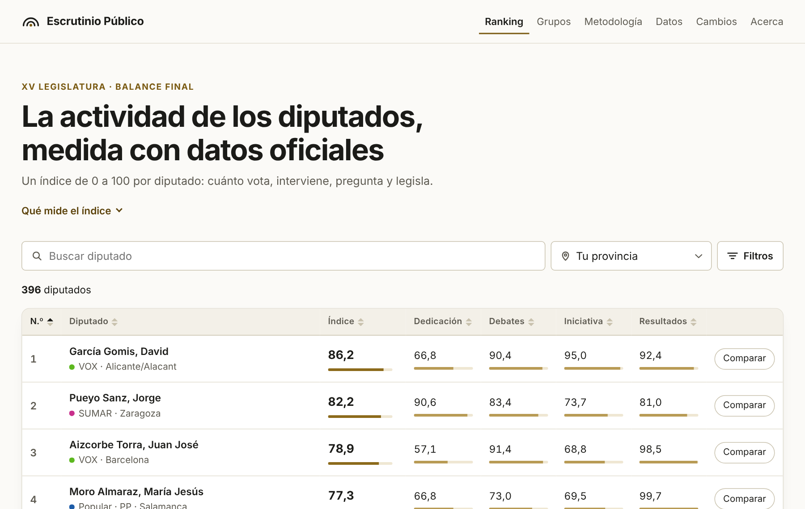
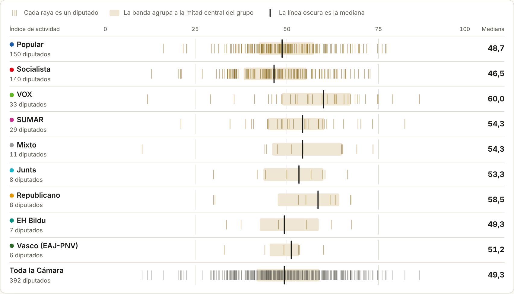

# Escrutinio Público

**[escrutiniopublico.es](https://escrutiniopublico.es)** muestra qué hace cada diputado del Congreso: cuánto vota, cuánto interviene, cuánto pregunta al Gobierno y en cuántas leyes aprobadas ha sido ponente. Todo sale de datos oficiales, y cada cifra indica su fuente y enlaza a los documentos originales.

Es un proyecto independiente. No tiene vinculación con el Congreso de los Diputados ni con ningún partido político.

## Qué encontrarás en la web

- **[Ranking](https://escrutiniopublico.es).** Los diputados, ordenados por un índice de actividad de 0 a 100. Se puede buscar por nombre y filtrar por grupo parlamentario, candidatura y circunscripción.
- **Ficha de cada diputado.** Su índice y su posición, cada cifra con el dato oficial detrás, la evolución mes a mes, sus cargos, sus últimas votaciones e intervenciones y las leyes de las que fue ponente.
- **[Grupos](https://escrutiniopublico.es/grupos).** Las mismas cifras sumadas por grupo parlamentario y por candidatura electoral, sin dar una nota a ningún grupo.
- **[Metodología](https://escrutiniopublico.es/metodologia).** Cómo se calcula el índice, con sus fórmulas, sus reglas y lo que no mide.
- **[Datos](https://escrutiniopublico.es/datos).** Todo lo que se ve en la web, para descargar y reutilizar.
- **[Cambios](https://escrutiniopublico.es/cambios).** El registro público de versiones, correcciones y rectificaciones.

Hoy la web recoge el balance completo de la XV Legislatura, de agosto de 2023 a octubre de 2026. Cuando empiece la siguiente, seguirá su actividad día a día.

## De dónde salen los datos

Solo de fuentes oficiales y públicas:

| Qué                                                                             | De dónde                                                                                                   |
| ------------------------------------------------------------------------------- | ---------------------------------------------------------------------------------------------------------- |
| Quién es diputado, su grupo, su candidatura y su circunscripción                | [Datos abiertos del Congreso: diputados](https://www.congreso.es/es/opendata/diputados)                    |
| El voto de cada diputado en cada votación del Pleno                             | [Datos abiertos del Congreso: votaciones](https://www.congreso.es/es/opendata/votaciones)                  |
| Las intervenciones en el Pleno y en las comisiones                              | [Datos abiertos del Congreso: intervenciones](https://www.congreso.es/es/opendata/intervenciones)          |
| Los proyectos y proposiciones de ley y sus ponentes                             | [Datos abiertos del Congreso: iniciativas](https://www.congreso.es/es/opendata/iniciativas)                |
| La composición de las comisiones, la Mesa y la Junta de Portavoces              | [Datos abiertos del Congreso: órganos](https://www.congreso.es/es/opendata/organos)                        |
| Las preguntas escritas y orales y las solicitudes de informe, con sus firmantes | [Buscador de iniciativas del Congreso](https://www.congreso.es/es/busqueda-de-iniciativas)                 |
| Qué diputados han sido miembros del Gobierno y en qué fechas                    | Los nombramientos y ceses publicados en el [Boletín Oficial del Estado](https://www.boe.es/datosabiertos/) |

Cómo se tratan:

- **Los datos del Congreso se actualizan cada día** de forma automática. Si un día la descarga falla o los datos no superan las comprobaciones, la web conserva los del día anterior.
- **No se corrige ninguna cifra a mano.** Solo dos listas pasan por una revisión humana, y las dos son públicas: las equivalencias entre las distintas formas en que los ficheros oficiales escriben un mismo nombre, y las fechas de los miembros del Gobierno, cada una con el real decreto que la respalda. Están en [`config/overrides.ts`](config/overrides.ts) y en [Cambios](https://escrutiniopublico.es/cambios).
- **Un dato que no existe no cuenta como cero.** Se muestra como «no disponible» y queda fuera del cálculo.
- **No se usan** las declaraciones de bienes e intereses ni las fotografías oficiales de los diputados, ni ninguna fuente que no sea oficial.

## Cómo se calcula el índice

El índice compara a cada diputado con el resto de la Cámara en cuatro aspectos, que pesan lo mismo:

| Dimensión                | Qué mira                                                               |
| ------------------------ | ---------------------------------------------------------------------- |
| Dedicación               | La participación en las votaciones del Pleno                           |
| Participación en debates | Las intervenciones en el Pleno y en las comisiones                     |
| Iniciativa parlamentaria | Las preguntas escritas y orales y las solicitudes de informe que firma |
| Resultados e impacto     | Las leyes aprobadas en cuya ponencia participó                         |

Una quinta dimensión, la atención a la circunscripción, no tiene fuente oficial y por eso no entra en el cálculo.

El índice mide cantidad de actividad registrada, no su calidad ni su acierto. Deja fuera buena parte del trabajo de un diputado, como la negociación o lo que ocurre a puerta cerrada. Las reglas son las mismas para todos, y los miembros del Gobierno no entran en el ranking. El detalle está en la [metodología](https://escrutiniopublico.es/metodologia).

## Código y datos abiertos

El código que descarga los datos, calcula el índice y genera la web está en este repositorio, para que cualquiera pueda comprobar de dónde sale cada cifra:

| Si quieres ver…                           | Mira en…                                             |
| ----------------------------------------- | ---------------------------------------------------- |
| Las reglas y los pesos del índice         | [`config/scoring.ts`](config/scoring.ts)             |
| Cómo se descargan y se calculan los datos | [`pipeline/`](pipeline)                              |
| Los datos, con su historial de cambios    | [`data/`](data)                                      |
| La web                                    | [`web/`](web)                                        |
| Por qué se tomó cada decisión             | [`docs/decisions.md`](docs/decisions.md)             |
| Qué significa cada campo de los datos     | [`docs/data-dictionary.md`](docs/data-dictionary.md) |

Para ejecutar el proyecto en tu ordenador, consulta [`docs/desarrollo.md`](docs/desarrollo.md).

## Errores y rectificaciones

Si un dato no coincide con la fuente oficial, o un diputado cree que su ficha contiene un error, puede [abrir una incidencia](https://github.com/garciaba/escrutiniopublico/issues/new) con la dirección de la página, el dato que se discute y el documento oficial que lo contradice. Las rectificaciones aceptadas se publican en [Cambios](https://escrutiniopublico.es/cambios).

## Licencias

- **Código:** [MIT](LICENSE).
- **Datos elaborados por Escrutinio Público:** [CC BY 4.0](https://creativecommons.org/licenses/by/4.0/deed.es). Se pueden reutilizar citando la fuente.
- **Datos de origen:** Congreso de los Diputados; su reutilización se rige por su [aviso legal](https://www.congreso.es/cem/aviso-legal).
